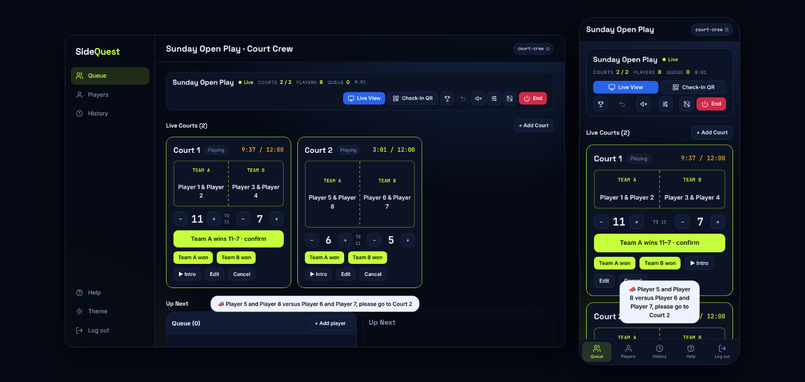

# SideQuest

Open-play queue manager for pickleball clubs. Check players in, build fair matches, send them to courts, keep score, and show it all on a TV. It runs entirely in the browser, works offline, and keeps your data on your own device.

[](https://github.com/YOUR-USER/YOUR-REPO/actions/workflows/ci.yml)



## Features

- **Check-in first.** Add players (or paste a list), set star levels, check them in as they arrive, then press Start.
- **Fair matching.** Everyone gets about the same number of matches. Four modes: Balanced, Social Mix, Skill Separated, Winners / Losers. Avoids repeat partners and opponents, supports locked partners, rest, singles and a limit on matches in a row.
- **Courts that run themselves.** One Up Next, send to a court, spoken call-outs, editable lineups, a match timer with warnings.
- **Live scoring** (optional) with play-to targets and a one-tap finish.
- **Undo** for results, cancelled matches and removed players.
- **Live View for a TV** in a second window, plus a check-in kiosk for a shared tablet.
- **Match intro animation** and sound (can be turned off).
- **Results, history and all-time stats**, CSV export, star suggestions, backup and restore as a file.
- **Works offline** and installs as an app on phones and laptops.
- **Private by design.** No accounts on a server, no tracking, nothing loaded from other sites.
- Light and dark themes, phone-first layout, keyboard friendly, accessibility scans clean.

## Run it locally

You need Node.js 20 or newer (only for the tiny dev server and tests).

```bash
npm install
npm start        # http://localhost:3000
```

There is no build step. Any static file server works (for example `npx serve .`). Open it over `http://localhost` or `https`, not by double-clicking the file, because the offline mode and password hashing need a secure context.

## Deploy

See [docs/DEPLOY.md](docs/DEPLOY.md). In short, for Vercel: import the repository, choose the **Other** preset, leave the build command empty and set the output directory to `.`. `vercel.json` adds the security headers.

## Test

```bash
npx playwright install chromium
npm test         # end-to-end tests + accessibility scans
npm run check    # syntax check
```

The tests run the app under the same security headers as production, check that nothing is requested from other sites, and cover sessions, scoring, undo, backups, offline use and accessibility.

## Project structure

```
index.html            page shell
assets/app.js         the app (sections marked with // ---------- name ----------)
assets/styles.css     styles and themes
sw.js                 service worker (offline)
manifest.webmanifest  install as an app
icons/  fonts/  vendor/
vercel.json  _headers security and caching headers
tests/                dev server + end-to-end tests
docs/                 deploy, architecture, launch checklist, privacy template
```

More detail: [docs/ARCHITECTURE.md](docs/ARCHITECTURE.md).

## Your data

Everything is saved in the browser (`localStorage`) on the device you use. Download a backup now and then (History → Backup), especially on Safari, which may clear saved data after about a week without a visit. Nothing is sent anywhere. See [docs/PRIVACY-TEMPLATE.md](docs/PRIVACY-TEMPLATE.md).

## Configuration

- **Name and logo text:** `BRAND` near the top of `assets/app.js`, plus `index.html`, `manifest.webmanifest` and `icons/`.
- **Version:** `APP_VER` in `assets/app.js`, `VERSION` in `sw.js`, and `package.json`.
- **Colours:** CSS variables at the top of `assets/styles.css`.

## Browser support

Current Chrome, Edge, Firefox and Safari (roughly 2023 and newer; the styles use `color-mix()`). Spoken call-outs need a browser with speech synthesis voices. Automated tests run in Chromium only, so please try other browsers before a launch (see [docs/LAUNCH-CHECKLIST.md](docs/LAUNCH-CHECKLIST.md)).

## Known limits

- Data lives on one device. There are no accounts on a server, no password reset email, and players cannot check themselves in from their own phones.
- The Live View second screen only works in the same browser on the same device.
- Inline event handlers mean the Content-Security-Policy still needs `'unsafe-inline'`.

## Before you launch

Read [docs/LAUNCH-CHECKLIST.md](docs/LAUNCH-CHECKLIST.md). It covers the product name, privacy, and real-device testing.

## Contributing, security, license

[CONTRIBUTING.md](CONTRIBUTING.md) · [SECURITY.md](SECURITY.md) · [CHANGELOG.md](CHANGELOG.md) · [MIT License](LICENSE)

Fonts (Inter, Space Grotesk, JetBrains Mono) are under the SIL Open Font License; see `fonts/licenses/`. The QR code generator is [qrcode-generator](https://github.com/kazuhikoarase/qrcode-generator) (MIT).
